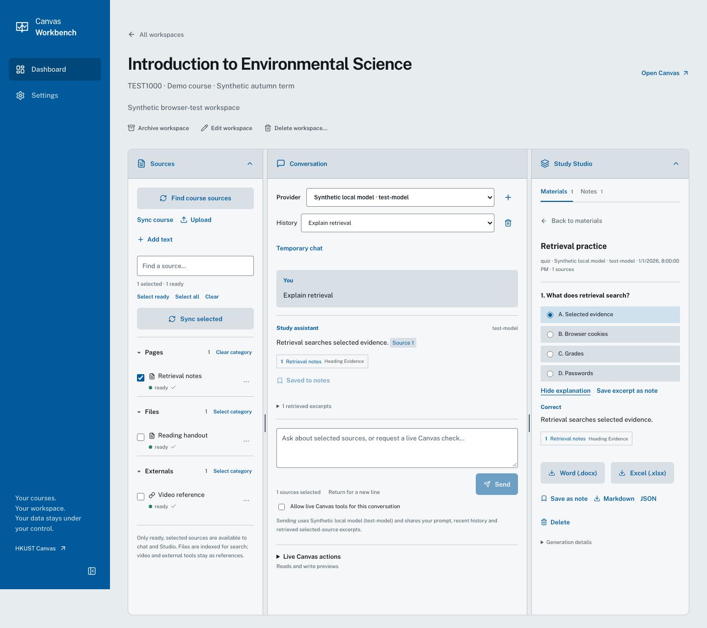

# HKUST Canvas Workbench

**Your Canvas. Your AI. Not just one model.**

This app connects HKUST Canvas to the AI tools that you select. You can use Claude, Codex, OpenAI, Anthropic, local models, OpenAI-compatible endpoints or an MCP client.

> **Unofficial, independent open-source project for HKUST Canvas users.**

**[Download for macOS · Apple Silicon](https://github.com/amzonmeeee/HKUST_Canvas_MCP/releases/tag/v3.0.0)** · [User guide](docs/user-guide.md) · [Developer install](docs/development.md) · [Security policy](SECURITY.md)

## Functions

* Open Canvas courses, or make your own workspaces.
* Sync Canvas sources, or add your own documents.
* Make local transcripts of HKUST RVC lecture recordings.
* Ask questions. The answers cite their sources.
* Make quizzes, flashcards, study guides, mind maps, slides, infographics, Word documents and spreadsheets.
* Read Canvas data. Before the app writes to Canvas, you must examine and confirm the change.
* Use Canvas through the browser, the CLI or an MCP client.

## Why this exists

HKUST now offers an AI learning platform [connected to Canvas](https://www.hkgai.org/products), powered by
**HKGAI-V3 — [based on DeepSeek V4](https://www.scmp.com/tech/tech-trends/article/3355861/hong-kong-launches-deepseek-based-ai-model-designed-run-domestic-chips)**. The “sources + chat + study outputs”
experience will look familiar to anyone who has used NotebookLM.

**The difference here is that the model is yours to choose.**

Use the same HKUST Canvas data with Claude, Codex, OpenAI, Anthropic,
local models, OpenAI-compatible endpoints, or any MCP-capable client —
with local ownership, open-source transparency, and no dependency on a
single AI stack.

## Install

1. Download the `.dmg` file from the [v3.0.0 release](https://github.com/amzonmeeee/HKUST_Canvas_MCP/releases/tag/v3.0.0).
2. Open the file. Move **HKUST Canvas Workbench.app** to Applications.
3. Open the app. If macOS blocks it, go to **System Settings → Privacy & Security → Open Anyway**.
4. Select the Chrome profile that you use for Canvas. Select **Check connection**.
5. Connect an AI provider, or select **skip for now**.
6. Open a course. Select **Find course sources**, then sync the sources.
7. Select a provider, then ask a question.

You must be signed in to `canvas.ust.hk` in Chrome. The app does not sign in for you.

For other install methods, see the [user guide](docs/user-guide.md#installation-options).

## RVC lecture recordings

1. Sync the course or its module pages. The recordings show under **RVC recordings**.
2. Open a recording.
3. Select **Install transcriber**. You do this one time. It downloads approximately 4–5 GB.
4. Select **Transcribe**. A 90-minute lecture takes approximately 15–20 minutes.

The transcript becomes a source. Chat and Studio can cite it by time. Audio is not sent to a server.

For more data, see [RVC recordings](docs/user-guide.md#rvc-lecture-recordings).

## Privacy

* Your Canvas cookies stay in the local backend. The app does not send them to AI providers.
* The app keeps sources, chats and notes on your computer.
* When you send a message, the AI provider gets your prompt and excerpts from the selected sources. It does not get the full course.
* Before the app writes to Canvas, it shows the exact change. You must confirm it.
* MCP clients can only read Canvas data, unless you enable write tools.

For more data, see [Safety and privacy](docs/user-guide.md#safety-and-privacy), [PRIVACY.md](PRIVACY.md) and [SECURITY.md](SECURITY.md).

## More information

* [User guide](docs/user-guide.md): setup, providers, MCP clients, troubleshooting, uninstall and roadmap.
* [Developer setup](docs/development.md) and [CLI reference](docs/cli.md).
* [Implementation reference](docs/v3-workbench.md) and [release engineering](docs/releasing.md).

## Disclaimer

This project is not affiliated with or endorsed by HKUST, Instructure or any AI provider. The software is provided as-is, without warranty.

AI output and synced Canvas data can be incomplete, late or incorrect. Always check submissions, deadlines and grades in Canvas. You must obey the policies and terms that apply to your course materials.

## Acknowledgements

This project is based on [ynbh/canvasmcp](https://github.com/ynbh/canvasmcp). amzonmeeee maintains it independently for HKUST Canvas. The original CLI, MCP tools, Chrome-session authentication and tests are its foundation. The original copyright notice stays in the [MIT License](LICENSE).
