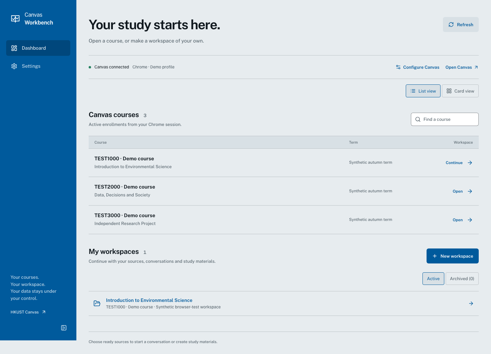
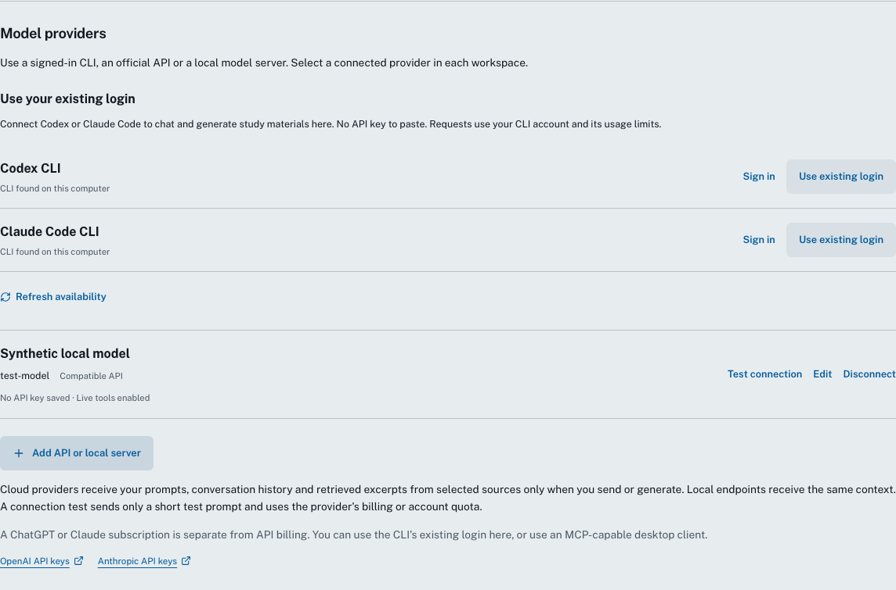
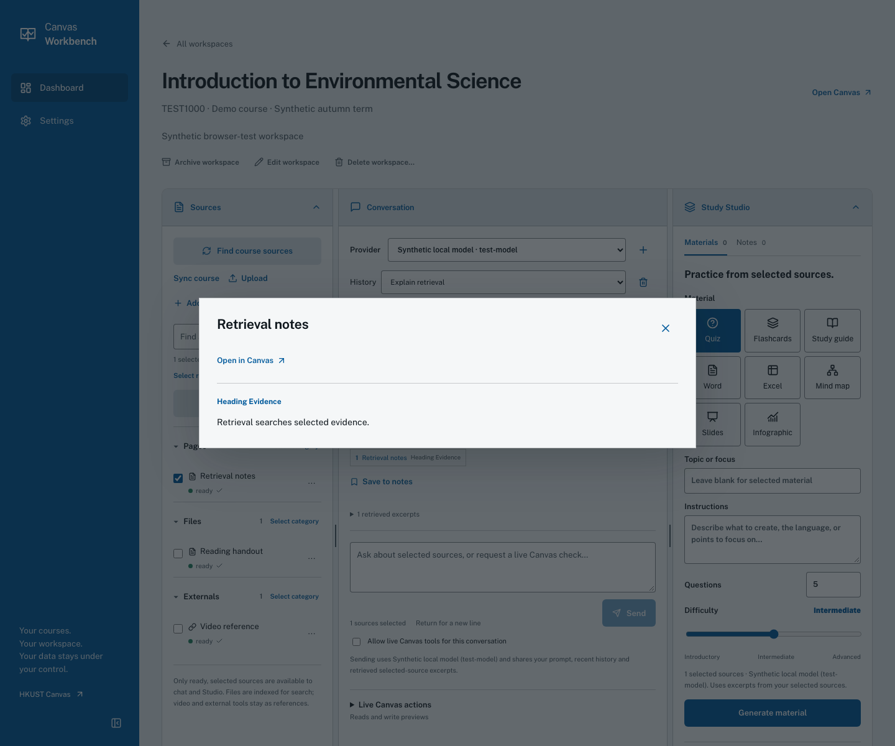
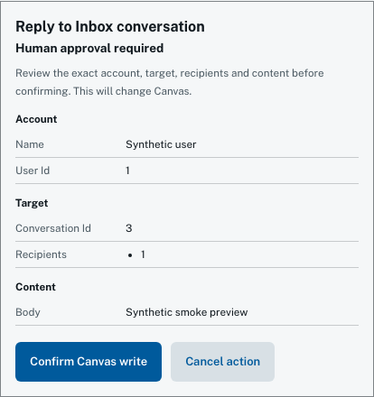

# User guide

## Setup

1. Download the Apple Silicon `.dmg` file from the [v3.1.0 release](https://github.com/amzonmeeee/HKUST_Canvas_MCP/releases/tag/v3.1.0).
2. Open the file. Move **HKUST Canvas Workbench.app** to Applications.
3. Open the app. The app opens your default browser. It shows a Dock icon while its service runs.
4. Select the Chrome profile that you use for Canvas. Select **Check connection**. Make sure that the app shows the correct account.
5. If the connection fails, open `canvas.ust.hk` in Chrome and sign in. Then try again. The app does not sign in for you (SSO).
6. Connect a Codex or Claude Code CLI that is already signed in. Or add an API or local provider. Or select **skip for now**.
7. Read the sharing notice and complete the setup.
8. Open a course. Select **Find course sources**. Select and sync the sources.
9. Select a provider, then ask a question.

To change the Chrome profile or a provider, go to **Settings**. The dashboard also has **Configure Canvas**.

To stop the service, quit the app with the app menu or ⌘Q. If you close the browser tab, the app continues to run. If you open the app again, it uses the service that runs.

### Open the first macOS release

Release v3.1.0 does not have an Apple Developer ID signature or notarization. Thus macOS can block the first launch.

1. Download the app only from the release page of this repository.
2. Compare the SHA-256 checksum of the file with `SHA256SUMS`.
3. Try to open the app.
4. If macOS blocks it, go to **System Settings → Privacy & Security → Open Anyway**.

Do not disable Gatekeeper. A managed Mac can need the approval of its administrator. See [Apple's guidance](https://support.apple.com/en-au/102445).

## Screenshots

The screenshots use synthetic courses, sources, users and model responses. They contain no student records and no private course material.

**Dashboard: courses and saved workspaces**



**Provider setup: CLI login, API or local endpoint**



**Citation: the excerpt that an answer uses**



**Write safety: exact account, target and content before confirmation**



## Safety and privacy

**Your Canvas session stays on your computer.** The app uses the Chrome session in which you are signed in to Canvas. Cookies and Canvas CSRF credentials stay in the Python backend. The app does not send them to the browser frontend or to AI providers. The app extracts, stores and indexes sources on your computer.

When you send or generate, a cloud provider gets these items:

* Your prompt.
* The related conversation history.
* Excerpts from the selected sources.

The provider does not get the full course automatically. If you enable live tools, they can also send Canvas results that you ask for. A local model gets the same context on its server. If that server is on your computer, the model processing stays there. Temporary chat does not change the data policy of a provider.

API keys are in the system credential store. There is no plaintext copy. The app does not send stored keys to the frontend, and they are not in this repository. Codex and Claude Code use their own CLI login. The app does not copy their tokens. A connection test sends a short prompt. It can use billing or account quota.

Canvas writes need an exact preview and your confirmation. **External MCP clients can only read data by default.** If you enable write tools, this does not approve an action. Check important submissions, grades and deadlines in Canvas.

You must make sure that your use of course materials, services and AI providers obeys the applicable policies, terms and rights.

See the [privacy summary](../PRIVACY.md) for data flows. See the [security policy](../SECURITY.md) for safeguards, unlink and disconnect behavior, and private reporting. Do not attach cookies, tokens, keys, private exports or logs to public issues.

## Supported AI providers

| Component | Validation for this release |
| --- | --- |
| Apple Silicon macOS app | Built and smoke-tested on macOS 27.0.1 and fresh macOS 15 CI; isolated HOME, native Quit, restart and singleton tests. Gatekeeper approval of a downloaded file is a manual check. |
| Chrome / multiple profiles | HKUST read/sync smoke during v3 development; synthetic connect, expiry, unlink and reconnect tests. Chrome must already be signed in. |
| Codex CLI | Real login, short streaming and structured output tested during v3 development; release CI uses synthetic adapters. |
| Claude Code CLI | Tested with synthetic adapters; real signed-in inference not verified. |
| Claude Desktop / Codex app | MCP configuration contracts tested; live desktop accounts not verified. Settings → MCP clients. |
| OpenAI / Anthropic API | Official streaming, tool, schema and failure contracts tested; paid-account access not verified. API billing is separate from a chat subscription. |
| Compatible API / Ollama / LM Studio | Compatible gateway smoke-tested over loopback. Configure the model and endpoint; particular local model installations are not certified. |
| Windows / Linux | Python/package tests and fresh wheel install pass on Ubuntu 24.04 CI; no Linux desktop installer. Windows is a developer route without platform validation. |

Select the model identifier yourself. A local endpoint must already run.

Scanned PDFs need OCR in a different program. v3 does not do OCR, and it does not extract authenticated LTI or external sites. Local transcription is available only for HKUST RVC recordings. For sync and parsing limits, see the [implementation reference](v3-workbench.md).

## RVC lecture recordings

HKUST RVC recordings are Canvas pages with titles such as `COMP1000-L1-2026-09-01-09-00`. The app finds them in two ways:

* In the Pages list, if the course shows it.
* In links on other pages, when you sync those pages. Many courses put these links on module pages.

The recordings show under **RVC recordings**. A sync does not transcribe a recording.

To make a transcript:

1. Open a recording.
2. Select **Install transcriber**. You do this one time.
3. Select **Transcribe**.

The install downloads the separate [RVC_Transcriber](https://github.com/amzonmeeee/RVC_Transcriber) component. The app downloads one pinned version and checks its hash. Then the component downloads approximately 4–5 GB: Python, FFmpeg and a speech model. All of these files go into the app data folder.

The app uses your Chrome sign-in to `rvcmedia.ust.hk` to get the stream link. If the app asks you to sign in, open a recording in Chrome one time. Then try again.

The component reads only the audio and makes the transcript on your Mac. A 90-minute lecture takes approximately 15–20 minutes on the GPU. Audio is not sent to a server.

The transcript becomes a ready source. The app adds it to your selection. Chat and Studio cite it by time, for example `Time 00:12:34`.

* To stop a transcription, select **Stop**. To continue later, select **Continue transcription**.
* To free the disk space, select **Remove transcriber**. The transcripts stay.
* The app cannot transcribe Zoom cloud recordings.

## MCP clients

Go to **Settings → MCP clients**. Connect a detected desktop app, or copy the setup. The macOS app gives the absolute path of its MCP program. You do not need to install a Python package. Keep the app in the same location before you configure clients.

The web workbench and MCP are separate interfaces. MCP clients can use Canvas tools without the workbench provider. To chat in the workbench, select a provider in the workspace. An MCP configuration does not select a chat provider.

For a developer installation:

```sh
canvas-mcp --transport stdio --read-only
```

To allow writes, replace `--read-only` with `--allow-writes`. `--read-only` overrides an environment setting. Get human approval for each exact preview before you use the confirmation tools. The CLI keeps its v2 preview and confirmation commands. See [developer setup](development.md) and the [CLI reference](cli.md).

## Installation options

* **macOS app:** download the DMG or the zipped `.app`. Both include the frontend and the Python runtime.
* **Python package:** a wheel and a source distribution are available for developers. Install the wheel with its `[web]` extra in a virtual environment. Then run `canvas web`. You need Node only to build the frontend again.
* **Source checkout:** see [developer installation](development.md). [Release engineering](releasing.md) gives the build and the checks.

An update keeps your study data. Do not replace or remove your data folder to update the app.

## Troubleshooting

| Problem | Action |
| --- | --- |
| No Canvas session, or the session expired | Sign in to Canvas in Chrome. Check the profile. Then select Check connection. |
| Chrome asks for credential access | Allow it only if you trust the app and the selected profile. Then check the account again. |
| No provider in a workspace | Connect a provider in Settings. Then select it in the workspace. MCP setup is separate. |
| The API connection fails | Check the model, quota and credential. For a local server, check the endpoint and the model that runs. |
| The app does not start | Use Show logs, Retry or Quit. Share only redacted metadata. Do not share session links. |
| The default port is in use | The launcher selects a free loopback port. Do not expose it on your network. |
| A write result is not clear | Check Canvas before you make a new preview. Each confirmation works one time. The app does not retry an unclear write. |
| An older web build does not open the database | Use v3.0.0 or later. Schema 6 keeps the data, but older builds cannot open it. |
| The transcriber asks you to sign in | Open a recording in Chrome and sign in to HKUST. Then select Transcribe again. |

<a id="uninstall"></a>

## Uninstall

1. **Credentials:** in Settings, disconnect the API providers. This removes only the credential-store items of the app. It does not sign out of CLI accounts.
2. **Canvas:** unlink Canvas to remove the shared CLI/MCP profile binding. This does not change your Chrome login or browser data.
3. **Application:** quit the app, then move it to Trash. If you configured MCP clients, remove the app entry from them.
4. **Study data (optional):** make a backup of the work that you want to keep. Then remove `~/Library/Application Support/HKUST_Canvas_MCP`. This permanently deletes sources, transcripts, conversations, notes, artifacts and the transcriber. It is separate from removing the app or unlinking Canvas.
5. **Profile settings (optional):** the app binding is in `~/.config/canvasmcp/settings.json` (or in `XDG_CONFIG_HOME`). The CLI and MCP also use it. Do not remove Chrome profiles or cookies.

If the app is already removed, its API credentials are system credential-store entries under `HKUST_Canvas_MCP.providers`, one for each provider ID. Remove only those entries. Do not clear your full Keychain. Launcher logs and session metadata are in the app data folder.

## Roadmap

- [x] Fetch and transcribe RVC recordings locally (optional transcriber in the detail view of a recording).
- [ ] Transcribe RVC recordings automatically in scheduled automation, or fetch Zoom transcriptions.
- [ ] v3.1 or later: read-only MCP access to saved workspaces, indexed sources, search and artifacts. External agents can then use the same materials as the browser. These tools are planned. They are not in v3.0. Signing, notarization and more platform tests are also next steps.
